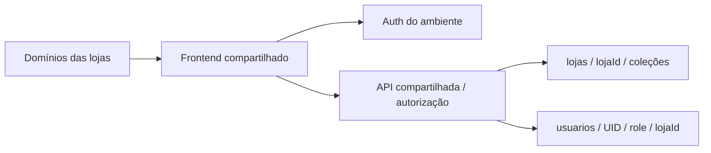

> Registro histórico da etapa indicada no título. A referência corrente é [README](../README.md) e a documentação da Etapa26. Datas, testes e decisões abaixo pertencem ao seu momento; não comprovam implantação comercial.

# Etapa 25 — Arquitetura de produção proposta

Data: 13/10/2026, America/Sao_Paulo. Preparação local, Ordem 12; decisões comerciais ainda sujeitas à aprovação. Sem implantação nem Etapa 26.

## Recomendação principal

Um frontend React/Vite compartilhado no Cloudflare Pages; uma API Express compartilhada no Cloud Run; um projeto Firebase por ambiente (homologação e produção separados), com Firestore Standard e Auth. Desenvolvimento/testes usam somente projeto demo com Emulator. Preservar demo como fonte reutilizável, dados comerciais no Firestore e isolamento autorizado pelo backend, sem um servidor por restaurante.

O mapa público VITE_LOJAS_POR_HOST associa domínios exatos a lojaId, no mesmo bundle. Host desconhecido falha fechado; query string não seleciona loja. VITE_LOJA_ID continua alternativa de instância individual e default local. Mapa é configuração pública, não permissão: backend verifica UID/role/loja em cada rota privada. Cache do carrinho permanece por loja e tentativas por loja/UID.

O mapa é estático no build: adicionar loja exige revisão do mapa, CORS e Authorized Domains, novo build/versão comum e associação DNS/certificado autorizada. Não existe onboarding automático nem descoberta por domínio não aprovado. Um deploy atualiza todas as lojas; validação em homologação, rollout controlado e rollback obrigatório reduzem o impacto compartilhado. Não prometer manutenção zero.

## Hospedagem do frontend

| Opção | Benefícios | Custos/limites e operação |
| --- | --- | --- |
| Cloudflare Pages, principal proposta | CDN/HTTPS, mesmo artefato, domínios e rollback; separa estáticos da API | Limites Free:100 domínios/projeto,500 builds/mês,1 build simultâneo,100 projetos/conta. Cenário 150 domínios exige plano/limite aprovado (Pro 250 domínios) ou alternativa; não provisionado |
| Firebase Hosting, alternativa preparada | Integração com projeto Firebase, HTTPS, rewrite SPA e releases | Transferência/armazenamento cobrados após franquias; confirmar limites de certificados/subdomínios no desenho escolhido |
| Instância/build por loja | Personalização e rollout isolado | Multiplica configuração e releases; usar apenas contratos que justifiquem custo operacional |

[Limites oficiais Pages](https://developers.cloudflare.com/pages/platform/limits/), [domínios Pages](https://developers.cloudflare.com/pages/configuration/custom-domains/), [Firebase Hosting](https://firebase.google.com/docs/hosting/), [domínios Hosting](https://firebase.google.com/docs/hosting/custom-domain?hl=en). Consultados 13/10/2026. Não assumir wildcard automático nem suporte ilimitado a domínios. Na etapa 25 não houve conexão a provedores.

Configuração Cloudflare está em infra/hosting/cloudflare-redirects.example e cloudflare-headers.example; copiar para public/_redirects e public/_headers SOMENTE após escolha aprovada. Manter uploads manuais autorizados; integração Git com auto-publicação desabilitada. Alternativa Firebase em firebase.preparacao.json: public ../../demo/dist, fallback /index.html, assets versionados immutable e HTML revalidado. O caminho public é relativo ao diretório do arquivo de configuração; ../../demo/dist foi corrigido após reprodução de 404 no Hosting Emulator e validado no local. Não executar deploy.

## Backend

Cloud Run mantém runtime Node/Express e ADC por service account gerenciada. Dockerfile com Node24.19.0 fixado por digest, npm ci, contexto sem env/testes e usuário node não root. PORT obrigatória válida e SIGTERM drena conexões até 10 s. / é health de processo, não prova de disponibilidade Firestore/Auth. Usar API base HTTPS separada, sem rewrite API ambiguamente tratado como SPA.

Proposta inicial a validar:1 vCPU/512 MiB–1 GiB, minInstances 0, maxInstances 3, concorrência 20, timeout 30 s; valores são candidatos, não capacidade medida nem configuração provisionada. Cold starts/min 0 e revogação de token com consulta Auth afetam latência. A memória da etapa 24 inclui harness/SDK; não é sizing de container. Medir workload antes de contratar SLA. MaxInstances reduz exposição, mas não representa teto absoluto de custo; orçamento é alerta.

Alternativa Node gerenciado (Render): operação simples e instâncias fixas, porém ADC/federação com Google deve ser comprovada; não distribuir JSON privado para facilitar implantação. Custos recorrentes/workspace/banda, região e cold starts devem ser revisados. [Serviços Render](https://render.com/docs/web-services), [preços](https://render.com/pricing). VPS: potencial controle maior, mas atualização, TLS, backup e monitoramento tornam operação mais manual; não recomendada inicialmente.

## Multi-loja e falhas compartilhadas

Firestore: usuarios/{uid}; lojas/{lojaId}; subcoleções produtos/categorias/clientes/pedidos/idempotencia; enderecos em clientes/{uid}/enderecos. Não duplicar projetos por cliente no início. Auth por ambiente compartilha UID entre lojas, perfil/endereço permanece no escopo da loja. Admin atual possui um único lojaId por documento usuarios; gestão multi-loja pelo mesmo admin não é funcionalidade implementada. Não ampliar permissão automaticamente.

Projeto dedicado por cliente é alternativa para exigência contratual/regulatória ou carga excepcional, com custo maior e plano de migração. Falha de API, conta faturadora ou projeto Firebase pode afetar todos; monitoração, backups separados e recuperação por prefixo são obrigatórios. Rate limit em memória não é proteção distribuída (R-023). Tráfego de uma loja não possui cota comercial isolada implementada; camada de borda e métricas precisam ser homologadas.

## Domínios/HTTPS e decisões abertas

Proposta: domínio de plataforma e loja-a.example.com/loja-b.example.com; personalizados opcionais. Os exemplos não são domínios registrados. Escolher região Firestore/API conjuntamente, considerando clientes no Brasil, latência, preço e política de dados. Custos us-central1 são referência, não escolha final.

DNS/certificados, CORS de origens exatas HTTPS, Auth Authorized Domains e redirecionamentos fixos exigem ordem externa. Não usar returnUrl arbitrário nem confiar em Origin como autorização. Revisar certificados para 150 lojas e alternativa Pages Pro antes de contratar. CSP deve passar por inventário de imagens/SDK/connect-src antes de enforcement; headers básicos preparados, sem CSP improvisada que bloqueie checkout.

Proprietário deve aprovar: provedor/plano, região, domínio principal e personalizados, orçamento, política de retenção/backup, SLA, estratégia de abuso e eventual federated identity. Recomendação técnica não cria recursos nem encerra ressalvas.
